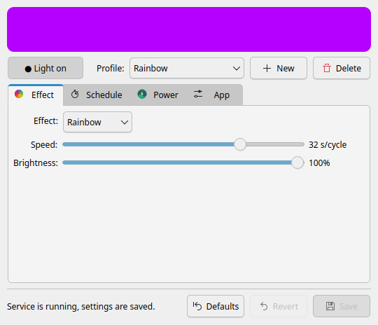
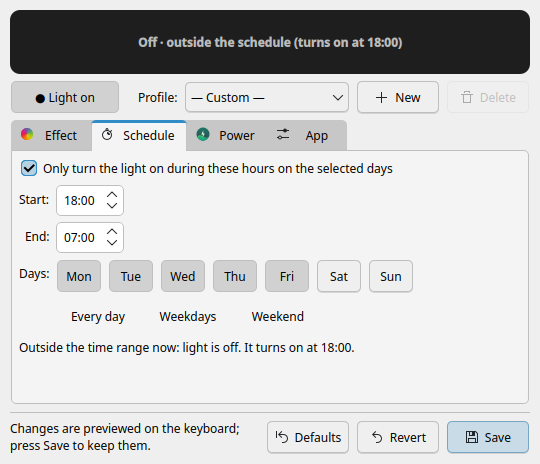
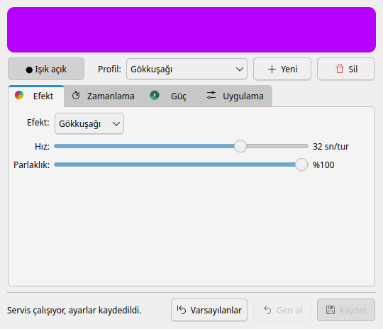

# Victus Keyboard Lighting for Linux

Control the RGB keyboard backlight of **HP Victus** laptops on Linux — the part of
OMEN Gaming Hub that doesn't exist on Linux. Static colors, a smooth rainbow, breathing,
color cycling, fire and heartbeat effects, a time schedule, battery rules, profiles and a
system-tray icon.

> 🇹🇷 Türkçe açıklama için aşağıdaki [Türkçe](#türkçe) bölümüne bakın.

<p align="center">
  
  
</p>

> **Unofficial project.** It is not affiliated with or endorsed by HP. It talks to the
> laptop firmware through the same HP BIOS WMI interface that OMEN Gaming Hub uses.
> It has been tested on the hardware listed below; use it on other models at your own risk.

---

## Contents

- [Features](#features)
- [Tested on](#tested-on)
- [Compatibility](#compatibility)
- [Requirements](#requirements)
- [Installation](#installation)
- [Usage](#usage)
- [Command line and keyboard shortcuts](#command-line-and-keyboard-shortcuts)
- [Configuration file](#configuration-file)
- [How it works](#how-it-works)
- [Updating and uninstalling](#updating-and-uninstalling)
- [Secure Boot](#secure-boot)
- [Troubleshooting](#troubleshooting)
- [Contributing](#contributing)
- [License](#license)
- [Türkçe](#türkçe)

## Features

- **Six effects:** static color, rainbow, breathing, color cycle (your own list of colors),
  fire (flickering embers) and heartbeat.
- **Speed and brightness** sliders. Brightness is done in software, so it also works on
  keyboards whose firmware has no brightness levels.
- **Live preview:** changes show up on the keyboard immediately. Nothing is stored until
  you press **Save**, and **Revert** returns to the saved settings.
- **Schedule:** keep the light on only between two times on the days you choose
  (ranges past midnight such as 19:00–07:00 work).
- **Battery rules:** when unplugged, keep the light as is, cap its brightness, or turn it off.
- **Profiles:** five built-in profiles, and you can save your own.
- **System tray icon** that shows the current keyboard color, with quick on/off and
  profile switching. Optional start at login.
- **Command line** (`victus-kbd --toggle`, `--profile`, `--next-profile`) for keyboard shortcuts.
- **Survives suspend/resume:** the color is re-sent periodically in case the firmware resets it.
- **English and Turkish** user interface: follows your system language, or pick one in the **App** tab.
- Runs as a small systemd service, so the effects keep running with the window closed
  and start again at boot.

## Tested on

This project was developed and tested on the following system:

| | |
|---|---|
| **Laptop** | HP Victus 16-r0045nt (`Victus by HP Gaming Laptop 16-r0xxx`) |
| **Board / SKU** | `8BBE` / `7P6C7EA#AB8` |
| **BIOS** | F.31 (2026-04-02) |
| **CPU / GPU** | Intel Core i5-13500H / NVIDIA GeForce RTX 4060 Laptop |
| **Keyboard** | Single-zone RGB backlight |
| **OS** | Fedora Linux 44, KDE Plasma 6.7 (Wayland) |
| **Kernel** | 7.2.11-200.fc44.x86_64 |
| **Python / Qt** | Python 3.14, Qt 6.11, PyQt6 6.11 |
| **Secure Boot** | Disabled |

Everything in this README — effects, schedule, battery rules, tray, CLI and the DKMS
install — has been verified on this machine. The automated test suite (`tests/`) also runs
on every push.

## Compatibility

- **Same model (Victus 16-r0xxx, board 8BBE):** expected to work out of the box.
- **Other HP Victus / OMEN laptops with an RGB keyboard:** likely to work. The module uses
  the HP "four-zone" lighting WMI call that OMEN Gaming Hub uses on many models. On
  four-zone keyboards all zones get the same color. The installer checks that the call
  works before it finishes, and the module refuses to load if it doesn't.
- **Laptops with a white-only backlight or no backlight:** not supported.
- **Desktop environments:** any. The tray icon needs a system tray (KDE Plasma, Cinnamon,
  XFCE, … — on GNOME install the *AppIndicator and KStatusNotifierItem Support* extension).
- **Distributions:** anything with systemd, Python 3.8+, PyQt6 (Qt 6.4+) and the headers for
  your running kernel. Install commands are listed below for Fedora, Ubuntu/Debian, Arch and openSUSE.

Got it working (or not) on another model? Please
[open an issue](../../issues/new?template=hardware_report.md) so it can be added here.

To see your model:

```bash
cat /sys/class/dmi/id/product_name /sys/class/dmi/id/board_name
```

## Requirements

Install the dependencies for your distribution:

**Fedora**
```bash
sudo dnf install python3-pyqt6 kernel-devel-$(uname -r) gcc make dkms
```

**Ubuntu / Debian** (Ubuntu 24.04+ / Debian 12+, which ship Qt ≥ 6.4)
```bash
sudo apt install python3-pyqt6 linux-headers-$(uname -r) build-essential dkms
```

**Arch Linux / Manjaro / CachyOS** (use the headers that match your kernel, e.g. `linux-zen-headers`)
```bash
sudo pacman -S python-pyqt6 linux-headers base-devel dkms
```

**openSUSE**
```bash
sudo zypper install python3-PyQt6 kernel-devel gcc make dkms
```

`dkms` is optional but strongly recommended: it rebuilds the kernel module automatically
after kernel updates. Without it you have to run `install.sh` again after every kernel update.

## Installation

```bash
git clone https://github.com/halitbarut/victus-keyboard-lighting-linux.git
cd victus-keyboard-lighting-linux
sudo ./install.sh
```

The installer:

1. checks the dependencies (and prints the right install command if something is missing),
2. builds and installs the `victus_kbd` kernel module (with DKMS if available),
3. loads the module and checks that the keyboard responds,
4. installs the app to `/usr/local`, the `victus-kbd` systemd service and a menu entry,
5. creates the settings in `/etc/victus-kbd/`, owned by your user so the app can save
   without `sudo`,
6. enables and starts the service. The default effect is the rainbow.

Then open **Victus Keyboard Lighting** from the application menu, or run `victus-kbd`.

Options: `--user NAME` sets which user owns the settings (default: the user running sudo),
`--no-dkms` builds the module without DKMS.

## Usage

**Top of the window**
- The colored strip is a live preview of what the keyboard shows. When the light is off it
  says why, for example *Off · outside the schedule (turns on at 19:00)*.
- **Light on / off** switches the light.
- **Profile** applies a saved profile. **New** saves the current effect, colors, speed and
  brightness as a profile; **Delete** removes the selected one. Profile changes are saved immediately.

**Effect tab** — choose the effect, its color (or colors for *Color cycle*), speed and brightness.

| Effect | What it does | Speed means |
|---|---|---|
| Static color | One steady color | — |
| Rainbow | Smoothly goes through every hue | Seconds per cycle (2–120 s) |
| Breathing | Slowly fades the color in and out | Seconds per breath |
| Color cycle | Fades through your own list of colors | Seconds for the whole list |
| Fire | Irregular flicker like embers | How lively the flicker is |
| Heartbeat | Double pulse, then rest | Beats per minute (40–150) |

**Schedule tab** — turn on *Only turn the light on during these hours…*, set start and end
times and pick the days. Overnight ranges belong to the day they start on: *Friday
22:00–02:00* is also on at 01:00 on Saturday.

**Power tab** — what happens when the charger is unplugged: keep the light as is, limit its
brightness, or turn it off.

**App tab** — language (automatic, Türkçe, English; the app restarts to switch), tray icon,
minimize to tray when the window is closed, start at login.

**Bottom bar** — **Save** (Ctrl+S) stores the settings, **Revert** drops unsaved changes,
**Defaults** resets everything except your profiles. Closing the window with unsaved
changes asks what to do; unsaved changes are never kept on the keyboard after the app closes.

**Tray icon** — the dot shows the current keyboard color. Left click opens/hides the window;
right click has *Light on*, *Profiles* and *Quit*. Tray actions are saved immediately.

## Command line and keyboard shortcuts

```text
victus-kbd                   open the window (or bring it to the front)
victus-kbd --tray            start in the tray without opening the window
victus-kbd --toggle          turn the light on/off
victus-kbd --on | --off      turn the light on / off
victus-kbd --profile NAME    apply a profile
victus-kbd --next-profile    switch to the next profile
victus-kbd --list-profiles   list profiles (* marks the current one)
victus-kbd --version
```

These commands only edit the settings file, so they need no `sudo` and work while the
window is open. To bind them to keys:

- **KDE Plasma:** System Settings → Keyboard → Shortcuts → Add New → Command or Script.
- **GNOME:** Settings → Keyboard → View and Customize Shortcuts → Custom Shortcuts.

Right-clicking the menu entry also offers *Toggle light* and *Next profile*.

## Configuration file

Settings live in `/etc/victus-kbd/config.json`. The service reloads the file as soon as it
changes, so you can also edit it by hand; invalid values fall back to defaults.

```json
{
  "enabled": true,
  "effect": "rainbow",
  "color": "ff0000",
  "colors": ["ff0000", "00ff00", "0000ff"],
  "speed": 75,
  "brightness": 100,
  "schedule": { "enabled": false, "start": "18:00", "end": "07:00", "days": [0, 1, 2, 3, 4, 5, 6] },
  "battery": { "mode": "same", "brightness": 30 },
  "profiles": { "Night": { "effect": "static", "color": "ff6a00", "colors": ["ff0000"], "speed": 75, "brightness": 20 } }
}
```

| Key | Values |
|---|---|
| `effect` | `static`, `rainbow`, `breathing`, `cycle`, `fire`, `heartbeat` |
| `color`, `colors` | `RRGGBB` hex |
| `speed`, `brightness` | 1–100, 0–100 |
| `schedule.days` | 0 = Monday … 6 = Sunday |
| `battery.mode` | `same`, `dim`, `off` |

## How it works

```
 victus-kbd (GUI, tray, CLI)  ── writes ──▶  /etc/victus-kbd/config.json   (saved settings)
        │                                    /etc/victus-kbd/preview.json  (unsaved, live preview)
        │                                              │ reads
        ▼                                              ▼
   preview strip                      victus-kbd-daemon (root, systemd)
                                         computes 20 frames/s
                                                       │ writes
                                                       ▼
                         /sys/devices/platform/victus-kbd/color   (kernel module victus_kbd)
                                                       │ HP BIOS WMI call
                                                       ▼
                                                   keyboard LEDs
```

- **`module/victus_kbd.c`** — a small kernel module that calls the HP BIOS WMI method
  (`5FB7F034-2C63-45E9-BE91-3D44E2C707E4`, command `0x20009`) to read and write the
  keyboard color. It exposes:
  - `color` — read/write, `RRGGBB` (sets all zones),
  - `brightness` — read/write, `0`/`1`. Some firmware, including the tested one, ignores this,
    so the daemon turns the light off by sending black,
  - `brightness_raw` — the raw firmware value, for diagnostics.
- **`victus_kbd/daemon.py`** — the root service that runs the effect, schedule and battery
  rules and writes the color to sysfs. A preview file wins over the saved settings while
  the GUI keeps refreshing it, and is ignored 5 seconds after the GUI stops.
- **`victus_kbd/gui.py`** — the PyQt6 window, tray icon and command line.
- **`victus_kbd/effects.py`** — effect math, schedule and config handling shared by both.

The module is **not** loaded automatically on every HP laptop: it has no WMI alias and is
loaded only by `victus-kbd.service`.

## Updating and uninstalling

**Update:**
```bash
cd victus-keyboard-lighting-linux
git pull
sudo ./install.sh
```
Your settings are kept. If the app is open, quit it from the tray and start it again.

**Uninstall:**
```bash
sudo ./uninstall.sh          # keeps /etc/victus-kbd
sudo ./uninstall.sh --purge  # also deletes the settings
```

## Secure Boot

With Secure Boot enabled, the kernel only loads signed modules.

- **Ubuntu / Debian:** DKMS signs the module with a Machine Owner Key (MOK). The first time,
  it asks for a password; reboot, choose *Enroll MOK* in the blue screen and enter it.
- **Fedora and others:** DKMS creates a key in `/var/lib/dkms/` and signs with it. Enroll it once:
  ```bash
  sudo mokutil --import /var/lib/dkms/mok.pub
  ```
  then reboot and choose *Enroll MOK*.
- Alternatively, disable Secure Boot in the BIOS setup.

## Troubleshooting

**The keyboard doesn't change / the app says the service is not running**
```bash
systemctl status victus-kbd
journalctl -u victus-kbd -b
```

**The module doesn't load** (`modprobe victus_kbd` fails)
```bash
sudo dmesg | grep victus_kbd
```
- *keyboard color query failed* — this model doesn't support the lighting call. Please open
  a hardware report with your model.
- *Key was rejected by service* / *Required key not available* — see [Secure Boot](#secure-boot).
- After a kernel update without DKMS: run `sudo ./install.sh` again.

**The light is "stuck" on a color** — the schedule or battery rule probably turned it off.
The preview strip in the app tells you why. Since version 1.0 the daemon sends black in that
case, so the keyboard goes dark instead of freezing.

**The light was turned off with the Fn key** — the app doesn't track the Fn backlight key.
Press it again.

**No tray icon on GNOME** — install the *AppIndicator and KStatusNotifierItem Support* extension.

**The settings can't be saved** — `/etc/victus-kbd` must belong to your user:
```bash
sudo chown -R $USER /etc/victus-kbd
```

**Hardware info for a bug report**
```bash
cat /sys/class/dmi/id/{product_name,board_name,bios_version}
cat /sys/devices/platform/victus-kbd/brightness_raw
uname -r
```

## Contributing

Bug reports, hardware reports, translations and pull requests are welcome. See
[CONTRIBUTING.md](CONTRIBUTING.md) for how to run the app and tests without installing anything.

## License

[MIT](LICENSE) © 2026 Mehmet Halit Barut.

The kernel module (`module/victus_kbd.c`) is dual-licensed **MIT or GPL-2.0**, because the
Linux kernel only lets GPL-compatible modules use the WMI functions it needs.

---

## Türkçe

HP Victus dizüstü bilgisayarların RGB klavye ışığını Linux'ta kontrol etmek için bir uygulama.
Windows'taki OMEN Gaming Hub'ın klavye ışığı kısmının Linux karşılığı.

<p align="center"></p>

> **Resmi olmayan bir projedir**, HP ile bir bağlantısı yoktur. Aşağıdaki sistemde test edilmiştir;
> başka modellerde kullanım sorumluluğu size aittir.

### Özellikler

- **6 efekt:** sabit renk, gökkuşağı, nefes, renk geçişi (kendi renk listeniz), ateş, kalp atışı
- **Hız ve parlaklık** ayarı
- **Canlı önizleme:** değişiklikler klavyede anında görünür, **Kaydet**'e basınca kalıcı olur
- **Zamanlama:** seçtiğiniz günlerde, belirli saatler arasında açık kalsın (19:00–07:00 gibi gece aralıkları da olur)
- **Pil ayarı:** şarj takılı değilken aynı kalsın, parlaklık düşsün ya da ışık kapansın
- **Profiller**, **sistem tepsisi simgesi**, **komut satırı** ve klavye kısayolları
- Arayüz sistem diline göre **Türkçe** ya da **İngilizce** açılır; **Uygulama** sekmesinden dili elle de seçebilirsiniz

### Test edilen sistem

HP Victus 16-r0045nt (anakart 8BBE, BIOS F.31), tek bölgeli RGB klavye, Fedora 44, KDE Plasma 6.7 (Wayland),
kernel 7.2.11, Secure Boot kapalı. Tüm özellikler bu bilgisayarda denenmiştir. Aynı modele sahipseniz
sorunsuz çalışması beklenir; diğer Victus/OMEN modellerinde de büyük ihtimalle çalışır.

### Kurulum

1. Bağımlılıkları kurun (Fedora için; diğer dağıtımlar yukarıdaki [Requirements](#requirements) bölümünde):
   ```bash
   sudo dnf install python3-pyqt6 kernel-devel-$(uname -r) gcc make dkms
   ```
2. Projeyi indirip kurun:
   ```bash
   git clone https://github.com/halitbarut/victus-keyboard-lighting-linux.git
   cd victus-keyboard-lighting-linux
   sudo ./install.sh
   ```
3. Uygulama menüsünden **Victus Klavye Işığı**'nı açın ya da terminalde `victus-kbd` yazın.

Kurulum scripti eksik paket varsa hangi komutla kuracağınızı söyler. DKMS sayesinde kernel
güncellemelerinde modül otomatik yeniden derlenir.

### Kullanım

- **Efekt** sekmesinden efekti, rengi, hızı ve parlaklığı seçin, sonra **Kaydet**'e basın.
- **Zamanlama** sekmesinden ışığın hangi gün ve saatlerde açık olacağını ayarlayın.
- **Güç** sekmesinden şarj takılı değilken ne olacağını seçin.
- Sistem diliniz İngilizce ise **App → Language** kısmından **Türkçe**'yi seçin; uygulama Türkçe olarak yeniden açılır.
- Üstteki renkli şerit klavyenin o anki halini gösterir. Işık kapalıysa nedenini yazar.
- Pencereyi kapatınca uygulama sistem tepsisine küçülür. Tepsi simgesine sağ tıklayarak ışığı
  açıp kapatabilir, profil değiştirebilirsiniz.
- Klavye kısayolu için: `victus-kbd --toggle`, `victus-kbd --profile Gece`, `victus-kbd --next-profile`.
  KDE'de: Sistem Ayarları → Klavye → Kısayollar → Yeni Ekle → Komut veya Betik.

### Güncelleme ve kaldırma

```bash
git pull && sudo ./install.sh     # güncelle (ayarlar korunur)
sudo ./uninstall.sh               # kaldır (ayarlar /etc/victus-kbd içinde kalır)
sudo ./uninstall.sh --purge       # ayarlarla birlikte kaldır
```

### Sorun giderme

- Klavye değişmiyorsa: `systemctl status victus-kbd` ve `journalctl -u victus-kbd -b`
- Modül yüklenmiyorsa: `sudo dmesg | grep victus_kbd`. Secure Boot açıksa yukarıdaki
  [Secure Boot](#secure-boot) bölümüne bakın.
- Işık bir renkte kalmış gibiyse büyük ihtimalle zamanlama ya da pil ayarı ışığı kapatmıştır;
  uygulamadaki şerit nedenini gösterir.

Sorun bildirmek veya katkıda bulunmak için [CONTRIBUTING.md](CONTRIBUTING.md) dosyasına bakın.
Lisans: [MIT](LICENSE) (çekirdek modülü MIT veya GPL-2.0).
